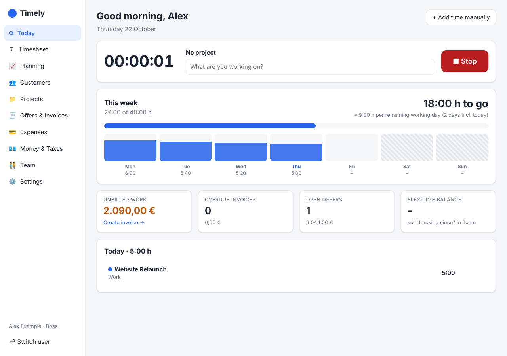
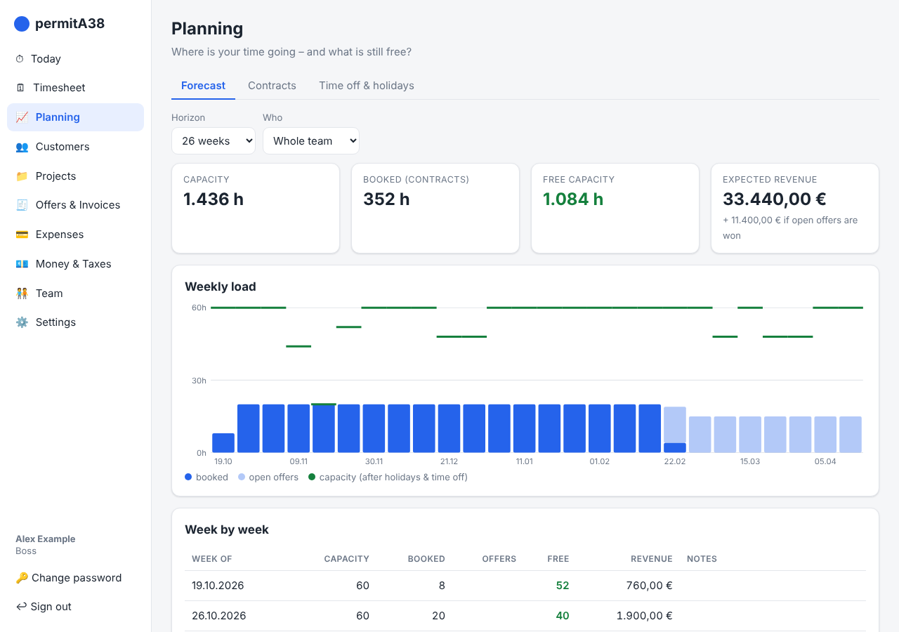
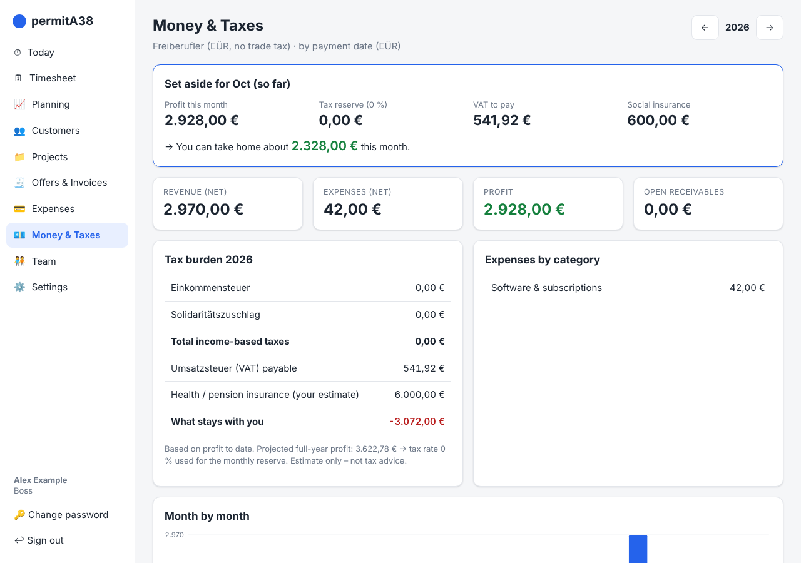
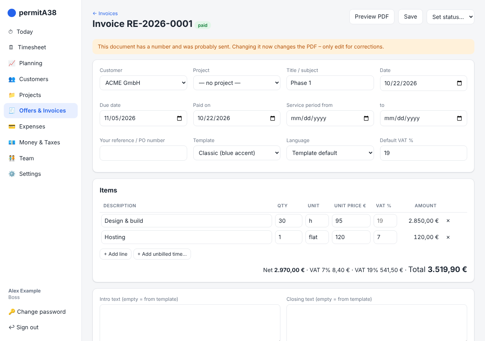
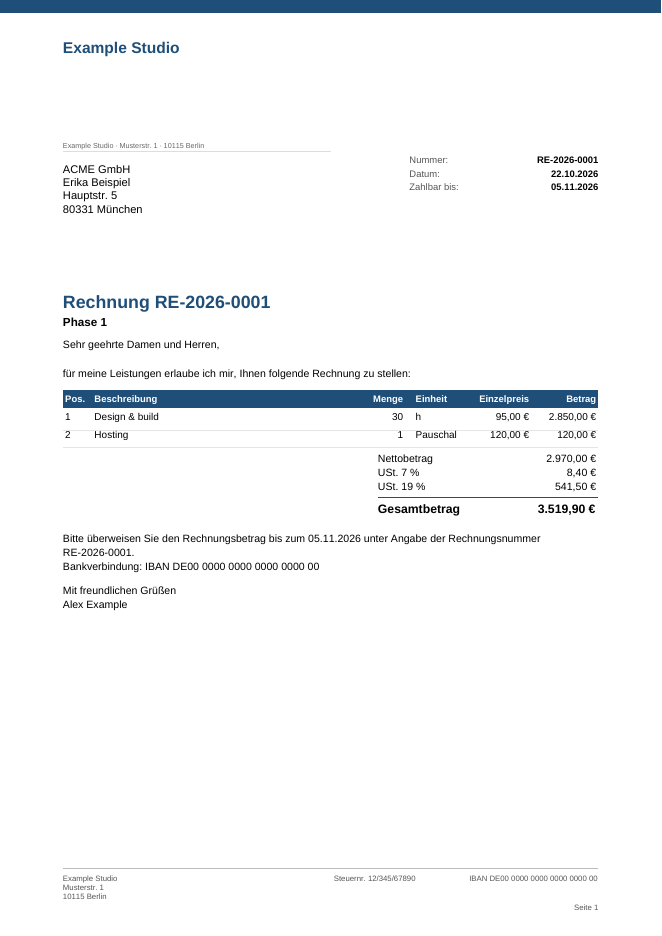
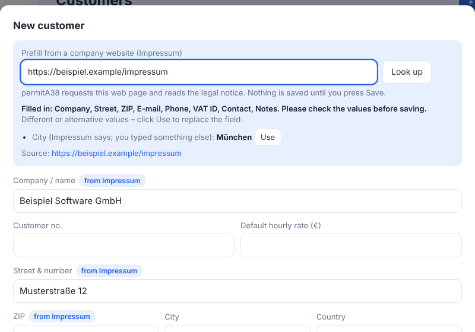

# ⏱ permitA38

[](LICENSE)

**Time tracking, planning, offers, invoices and tax reserves for freelancers and small businesses in Germany.**
One small app, one SQLite database in a folder you own, synced across all your devices with Syncthing.


permitA38 answers the questions a freelancer actually asks every day:

- *How many hours do I still have to work this week?*
- *Do I have capacity for that new project in January?*
- *What did I earn this month – and how much of it is **not** mine (VAT, income tax, trade tax)?*
- *Which work have I done but not yet invoiced?*

It runs on **Windows and Linux** (anything with Python 3.10+), needs **no database, no cloud and no account with anyone but yourself**. Your data stays in a folder you own.

> New here? Read the **[Getting started guide](docs/getting-started.md)** – you'll be tracking time in 5 minutes.



---

## Features

| | |
|---|---|
| **⏱ Time tracking** | One-click timer or manual entries for customers and personal projects, with tasks, notes and a billable flag. A running timer shows up on your other devices, too. |
| **🎯 Weekly goal** | "You still need **17:30 h** this week – about **4:22 h** per remaining day." Takes public holidays and your time off into account. Optional flex-time balance. |
| **📈 Forecast** | Enter contracts (hours per week *or* a total hour budget between two dates). permitA38 lays them out week by week, compares them with your capacity and shows free hours and expected revenue. Open offers appear as *tentative* load. |
| **🏖 Holidays & time off** | Vacation, personal days, sick days – plus German public holidays for your federal state. They reduce capacity in the forecast. |
| **💶 Rates** | Hourly rate per customer, project, **task**, or person. The most specific one wins: *task → project → customer → person → default*. |
| **👥 Customers** | Address, tax number, VAT ID, point of contact, notes, default rate – and a history of their projects, offers and invoices. **Prefill a new customer from the Impressum of their website** (you check and confirm every value). |
| **🧾 Offers & invoices** | Create an offer → send → mark accepted (creates project and contract) → bill by tracked time or by items. PDFs from templates you choose (DIN 5008 layout, German or English, logo support). Gap-free numbering, VAT per line, Kleinunternehmer (§19 UStG) support. |
| **💳 Expenses** | Enter bills with an attached PDF/photo, assign them to a project or keep them as general expenses. VAT is split out automatically. |
| **🏛 Taxes (Germany)** | Dashboard for revenue, profit, VAT and income-based taxes for **Freiberufler**, **Gewerbetreibende** (incl. Gewerbesteuer with §35 credit) or **UG/GmbH**. Shows your monthly *set-aside* and what's left for you. |
| **🧑‍🤝‍🧑 Team & roles** | Add people to your workforce. **Members** track their own time and time off. **You, the boss,** plan, bill and see the money. Every person has their own login. |
| **🗄 SQLite storage** | All data lives in one SQLite file (`permita38.sqlite3`) in your data folder – transactional, versioned schema migrations, automatic daily backups. Syncs with Syncthing, Nextcloud or Dropbox. |

### A look around

| Planning forecast | Money & taxes |
|---|---|
|  |  |

| Invoice editor | PDF output |
|---|---|
|  |  |

*(Screenshots show demo data.)*

---

## Quick start

**Requirements:** Python 3.10 or newer. The launcher creates a virtual environment and installs the (few) dependencies on first run.

```bash
git clone https://github.com/roggenbrot42/permitA38.git
cd permitA38

# Linux / macOS
./start-permita38.sh --data ~/Sync/permitA38

# Windows (double-click start-permita38.bat, or in a terminal:)
start-permita38.bat --data "C:\Users\you\Sync\permitA38"
```

Your browser opens at <http://localhost:8765>. On the first start you create your boss account – done.

- `--data` points to the folder where all your data lives. **It is remembered** in your per-device config file, so next time just run `./start-permita38.sh`.
- Without `--data` the folder defaults to `~/permitA38`. You can also set `PERMITA38_DATA`.
- Other options: `--port 8765`, `--host 0.0.0.0` (let your team reach it over your LAN), `--no-browser`, `-c path/to/config.yaml`.
- If you prefer pip: `pip install -e .` and run `permita38`.

> Tip: make a desktop shortcut / autostart entry for the launcher so permitA38 is one click away.

---

## Login & accounts

- **First run:** a setup screen creates the first account – the **boss** – with a username and a password (at least 8 characters).
- **Everyday use:** sign in with username and password. The server hands out a signed token (valid 12 hours); the web app sends it as `Authorization: Bearer …`. A same-site `HttpOnly` cookie carries the same token so that PDFs and attachments open in a new tab.
- **Team members:** the boss creates accounts under **Team** (username + initial password). Members can change their password via the account menu.
- **Protection:** passwords are stored only as salted PBKDF2-SHA256 hashes; five failed attempts lock a username out for a few minutes; changing a password signs out every other session.
- **Forgot your password?** Run on the machine that has the data:

  ```bash
  permita38 set-password <username>
  ```

> **Honest security note:** logins control what permitA38 *shows*. Because the data is plain files in a folder you sync, anyone who can open that folder can read all of it. Only share the sync folder with people you'd trust with the books. A real server mode (one hosted instance, nobody touches the files) is on the roadmap.

---

## Using permitA38 on all your devices (sync)

permitA38 has no cloud. **The data folder holds the database** (one SQLite file plus your attachments), and a file-sync tool moves it between your computers. This works offline, keeps your data private and costs nothing.

**With Syncthing (recommended):**

1. Install [Syncthing](https://syncthing.net/) on each desktop and share one folder, e.g. `~/Sync/permitA38`.
2. On every device, start permitA38 once with `--data` pointing at that folder.
3. Use it on any device with the same logins. Changes appear on the others within seconds (reload the page).

**How syncing a single database file behaves – honestly**

- **One device writes at a time: works great.** Work on the laptop, quit permitA38 (or just stop typing), let Syncthing finish, then open it on the desktop. SQLite writes are transactional and the database uses a plain rollback journal (no `-wal`/`-shm` side files), so a synced copy is always a complete, consistent database.
- **Two devices edit offline at the same time: you get a conflict copy of the *whole* database** (`permita38.sync-conflict-….sqlite3`). permitA38 detects these files, shows a warning banner, and will not merge them for you – you keep the version you want (and can copy missing entries over by hand). A row-level merge/sync mode is on the roadmap.
- **Rule of thumb:** quit permitA38 on a device before you switch to another one.
- **Safety nets:** permitA38 takes an **automatic daily backup** (newest 14 are kept in `<data folder>/backups/`) and a backup **before every schema migration**. Turn on Syncthing's *file versioning* (Staggered) for the data folder as a second undo history. `permita38 backup` makes one on demand.
- **Newer app version on another device?** The database records its schema revision. An older permitA38 refuses to open a database that a newer version already upgraded – update the older device instead of risking your data.
- Your running timer is stored per person, so you can start it on the laptop and stop it on the desktop.
- Each device has its own `config.yaml` (with its own secret signing key) – it is **not** in the synced folder, so logins/sessions are per device.

**Alternatives:** Nextcloud, Dropbox, OneDrive, a NAS share or a USB stick work the same way. For several people editing at once you want a server instead – see the roadmap (the storage layer is built so a PostgreSQL/MariaDB backend can be added: [docs/porting-to-postgres.md](docs/porting-to-postgres.md)).

---

## Roles and your team

| | Boss | Member |
|---|:---:|:---:|
| Track own time, own time off | ✅ | ✅ |
| See projects they are assigned to | ✅ | ✅ |
| Customers, rates, contracts, forecast | ✅ | – |
| Offers, invoices, expenses, tax dashboard | ✅ | – |
| Edit others' time, manage team | ✅ | – |

---

## How the money part works

Set your **company type**, **federal state**, **Kleinunternehmer** status and **monthly health/pension insurance** under *Settings*. Then permitA38 computes, from your paid invoices and your expenses:

- **Revenue, expenses, profit** – for the month and for the year (EÜR logic: revenue counts when it is *paid*; switch to "when invoiced" in Settings if you do accrual accounting).
- **VAT payable** = VAT on your revenue − input VAT on your expenses (none for Kleinunternehmer).
- **Income tax** with the current §32a EStG tariff (2025/2026), optional splitting, church tax and **Solidaritätszuschlag**; **Gewerbesteuer** (Freibetrag 24,500 €, Hebesatz, §35 credit) for trade businesses; **KSt + Soli + GewSt** for UG/GmbH.
- **Monthly set-aside** = VAT + your projected effective tax rate × this month's profit + social insurance → *"You can take home about …"*.

> ⚠️ **These are planning estimates, not tax advice.** They simplify a lot (e.g. social insurance is treated as fully deductible, no Hinzurechnungen for Gewerbesteuer, no GmbH owner salary/dividends). Use them to know how much to put aside – and let your Steuerberater do the real calculation. Tax tables live in [`permita38/core/tax.py`](permita38/core/tax.py) and are easy to update each year.

---

## Prefill customers from their Impressum



In **Customers → New customer** you can enter a company's website (or the address of its Impressum page) and press **Look up**. permitA38 reads the legal notice that German and many EU websites must publish and fills in what it finds: company name and legal form, address, e-mail, phone, USt-IdNr, Handelsregister entry, managing directors and a contact person.

- **You stay in control.** Nothing is saved by the lookup. Empty fields are filled and marked *from Impressum* (hover for the text it was derived from and a confidence value); fields you already typed are never overwritten unless you click **Use**. Alternatives (e.g. a second e-mail address) are offered the same way.
- **Checked, not guessed.** There is no AI involved: the page is parsed with fixed rules (schema.org data first, then the usual German notice wording). A USt-IdNr must pass the official check-digit test, ZIP codes, e-mail addresses and phone numbers are validated, and anything that fails is shown as a warning instead of being filled in.
- **Privacy:** the lookup makes an outbound web request **from the machine that runs permitA38** to the website you entered (and at most a few of its own Impressum/Kontakt pages). No customer data is sent. If you do not want this, set `features.impressum_lookup: false` in the config (or `PERMITA38_FEATURE_IMPRESSUM_LOOKUP=false`); the button then disappears.
- **Safe by design:** only `http(s)` on the standard ports, no credentials in addresses, and every address a host name resolves to must be a public one – internal networks, localhost and cloud-metadata addresses are refused, also after redirects. Responses are limited in size and time and are never executed (no JavaScript). The lookup is rate-limited per user and available to the boss role only.
- **Limits:** web pages differ a lot. Always check the result; sites that build their Impressum with JavaScript, or show it as an image, cannot be read.

## Architecture

permitA38 is split into a **backend** (HTTP API) and a **frontend** that only talks to that API. The layout follows the approach of [stustapay](https://github.com/stustapay/stustapay).

```
web/                          vanilla-JS single-page app (no build step)   ──HTTP/JSON──┐
                                                                                       ▼
permita38/api/                FastAPI app: thin routers + auth dependencies (router per domain)
permita38/core/service/       services: business rules, permissions, numbering, timers, documents
permita38/core/               pure domain logic (rates, capacity, forecast, tax, holidays, PDF) + pydantic models
        │  depends only on the interface ▼
permita38/core/repository/    Repository interface (base.py)  ← the ONLY thing services/API may import
   ├─ schema.py               the database schema described once, dialect-neutral
   ├─ dialect.py              SQLite / PostgreSQL / MariaDB: DDL, upserts, placeholders (pure strings)
   ├─ sql.py                  generic SQL repository (records, settings, transactions, migrations)
   ├─ sqlite.py               SQLiteRepository – the default (and only shipped) backend
   ├─ factory.py              create_repository(config) picks the backend
   └─ importer.py, backups.py import of the old JSON layout, automatic backups
permita38/core/schema/migrations/<dialect>/0001_initial.sql   numbered migrations per dialect
api/openapi.json              the generated API contract
```

Layers: **web → API routers → services → `Repository` interface → backend/dialect → database file or server.**

- **Contract first:** the API is described by OpenAPI. `api/openapi.json` is committed (`make generate-openapi`, checked in CI); interactive docs are served at `/api/docs`. A mobile app or a different frontend can be generated from it.
- **Services, not routers, hold the logic.** Routers parse requests and call a service; services raise domain errors that the API maps to `{"detail": …}` responses.
- **Typed records, tolerant files:** pydantic models describe every record, but unknown fields are preserved so files written by a newer version or another device survive a round-trip.
- **Storage is a layer:** services, calculations, documents and the API depend only on the `Repository` interface (`core/repository/base.py`) – no SQL, no `sqlite3` outside the repository package. The default backend is **SQLite**; the interface, the dialect-neutral schema, per-dialect DDL/upsert generation and a backend-independent contract test suite are in place so a **PostgreSQL or MariaDB** backend is mostly wiring a driver ([porting guide](docs/porting-to-postgres.md)). *Honest status: only SQLite is implemented and tested; the PostgreSQL/MariaDB dialect classes and migration files are prepared but never ran against a real server.*
- **Versioned schema migrations**, stustapay-style: numbered SQL files per dialect (`0001_initial.sql`, …), the database stores its revision, `CURRENT_REVISION` in `core/database.py` says what the app expects. On start permitA38 applies pending migrations (after taking a backup) and **refuses to start** on a database that is newer than the app. `permita38 create-migration <name>` creates the next numbered file for every dialect.
- **Frontend hosted separately?** By default the API serves `web/` itself. To host the frontend elsewhere set `serve_web: false` and `cors_origins: ["https://your-frontend"]` in the config, and point the frontend at the API URL.

**Per-device config** (`~/.config/permita38/config.yaml`, on Windows `%APPDATA%\permita38\config.yaml`) is created on first run:

```yaml
data_dir: /home/you/Sync/permitA38
secret_key: <random, generated>   # signs login tokens; never share, never sync
host: 127.0.0.1
port: 8765
cors_origins: []
serve_web: true
features:
  impressum_lookup: true   # customer prefill reads a web page you enter; set false to switch it off
database:
  backend: sqlite          # sqlite (default). postgresql / mariadb are prepared, not shipped yet
  # path: permita38.sqlite3  # default: <data_dir>/permita38.sqlite3
  sqlite_wal: false        # WAL syncs badly (extra files) – keep off for synced folders
  auto_migrate: true
  auto_backup: true        # one backup per day in <data_dir>/backups, newest 14 kept
  backup_keep: 14
```

**Inspired by stustapay:** FastAPI + service layer + pydantic, OpenAPI contract between backend and frontend, bearer-token auth via dependencies, CLI sub-commands, ruff/mypy/pre-commit/CI conventions.
**Deliberately different:** SQLite instead of PostgreSQL and no always-on server – the synced folder holds the database so it works offline on a laptop (PostgreSQL is a prepared option, see above); no React/Nx build – the UI is plain JS you can read and change in a text editor.

---

## Where is my data?

```
permitA38/                  ← your data folder (sync this)
├── permita38.sqlite3       everything: users, customers, projects, time entries, contracts,
│                           offers, invoices, expenses, absences, templates, settings, timers
├── attachments/            uploaded bills and your logo (files)
└── backups/                automatic daily backups + one before each migration
```

The database is a normal SQLite file – open it with any SQLite tool (`sqlite3 permita38.sqlite3 .tables`), back it up like any file, or script against it. Real tables and typed columns (no JSON blob table); fields the app does not know yet are kept in a per-row `extra` JSON column so data written by a newer version survives. There are deliberately **no foreign-key constraints**: deleting a customer never blocks on or cascades into projects and invoices – the history stays intact.

**Coming from the earlier JSON-file version?** Import it once: `permita38 import-json <old data folder>` (idempotent; keeps ids and timestamps; old users get a derived username and need `permita38 set-password <username>`).

**Command line:** `permita38 migrate` · `permita38 backup [--dest FILE]` · `permita38 import-json DIR` · `permita38 create-migration NAME` · `permita38 dump-ddl --dialect postgresql` · `permita38 set-password USER`.

---

## Document templates

Pick a template per document: **Classic** (colour bar), **Modern** (header band, English) or **Minimal** (black & white) – or create your own under *Settings → Document templates*: layout, accent colour, language, intro/closing texts with placeholders such as `{customer_name}`, `{due_date}`, `{number}`. Upload a JPEG logo in Settings to put it on every document.

Invoices include what German law requires (§14 UStG): both addresses, tax number or VAT ID, sequential number, date, service period, net/VAT/gross per rate, and the §19 note for Kleinunternehmer.

---

## Run with Docker

Prefer one hosted instance over syncing folders? Run permitA38 as a container (Raspberry Pi, NAS, VPS) and use it
from every device's browser:

```bash
cp .env.example .env     # choose the boss username/password (created on first start)
docker compose up -d --build
```

Non-root, read-only filesystem, health check, HTTPS via the included Caddy proxy file, data in one volume.
See **[docs/docker.md](docs/docker.md)** for configuration, backups, HTTPS and a security checklist.

## Roadmap

- 📱 **Android companion app** – see [`docs/mobile-concept.md`](docs/mobile-concept.md): a small offline-first app on SQLite (native on Android), syncing the same database file or talking to a server.
- Optional **server mode**: a PostgreSQL/MariaDB backend behind the existing `Repository` interface ([porting guide](docs/porting-to-postgres.md)), and a row-level merge for the synced-file setup
- Recurring invoices, credit notes, reminders (Mahnungen)
- DATEV / CSV export for your tax advisor
- UI translations (currently English UI, German document templates)

Ideas and pull requests are welcome.

---

## Development

```bash
python -m venv .venv && . .venv/bin/activate
pip install -e ".[dev]"

make test              # pytest tests/backend (unit, API, repository contract, migrations)
make lint              # ruff + mypy
make format            # ruff formatter
make run               # start the server on :8765
make generate-openapi  # refresh api/openapi.json after changing routers/models
make check-openapi     # fail if the contract is stale (also runs in CI)
```

See [AGENTS.md](AGENTS.md) for repository conventions and [CHANGELOG.md](CHANGELOG.md) for what changed.

## Contributing

Contributions are welcome – see [CONTRIBUTING.md](CONTRIBUTING.md) (includes the sign-off / Developer Certificate of Origin all commits need) and [SECURITY.md](SECURITY.md) for vulnerability reports.

## License

permitA38 is free software, licensed under the **GNU General Public License v3.0 or later** – see [LICENSE](LICENSE). You may use, study, change and share it; derived works must stay under the same license.
